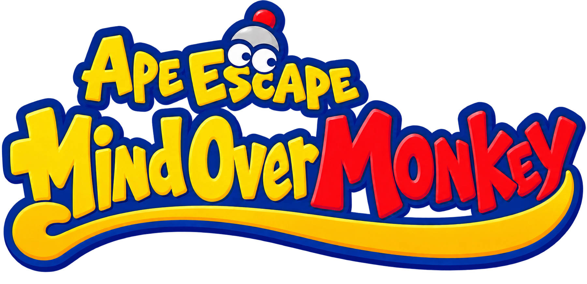

# Saru Get You: Saru Saru Daisakusen Recompilation



This is a recompilation project of **Saru Get You: Saru Saru Daisakusen**,
with the aim of making the game available on Windows, macOS, Linux, and Android
with improved performance and configurability, and providing a foundation for
translating the game.

The project currently runs on macOS arm64, with Linux and Windows builds being
brought up, and is
**not playable yet**. See the
[project plan](PLAN.md) and [profile instructions](profiles/sarusaru/README.md).

## Roadmap

The following milestones describe the project's goals, rather than currently
supported features. See [PLAN.md](PLAN.md) for detailed progress and acceptance criteria.

- Complete faithful gameplay: rendering, audio, movies and PSP services, verified
  through a representative level, saving, restarting and reloading.
- Verify PSP-compatible saves, with safe writes, backups, import and export.
- Improve graphics and controls with adjustable resolution, verified FOV and
  framerate options, fully rebindable controls and analog camera support.
- Build a shared launcher and in-game settings UI for ISO installation,
  configuration and save management, including Android setup and touch support.
- Provide translation infrastructure for text, fonts and texture replacements,
  with translation-pack support and Japanese fallback.
- Deliver tested, reproducible builds for Windows, macOS, Linux and Android,
  once platform verification and release requirements are met.

## PSPRecomp framework

The project is built on PSPRecomp. The upstream framework documentation follows below.

PSPRecomp is a static recompilation framework for PSP software. It reads an Allegrex/MIPS executable, analyzes guest code, emits C++ translation units, and runs them through a native host runtime instead of shipping a PSP interpreter or JIT.

The repository is split between a reusable framework and game-specific profiles. The first working profile is GTA: Vice City Stories (`profiles/vcs`).

## Repository layout

```text
include/psprecomp/   Public runtime and Allegrex interfaces
src/                 ELF/PRX loading, decoder, memory, runtime and support code
tools/               Generic analyzer, recompiler and reverse-engineering helpers
tests/               Framework regression tests
configs/             Generic examples and PSP NID data
profiles/            Game-specific hosts, generated code, configuration and tests
  vcs/               GTA: Vice City Stories profile
```

Game-specific addresses, HLE behavior, native fast paths, renderer integration and generated AOT code belong under a profile. The framework should remain usable without any profile selected.

## Requirements

- CMake 3.20 or newer
- A C++20 compiler
- Visual Studio 2022 for the current Windows/DX12 VCS build

## Build the framework only

```bash
cmake -S . -B out/framework -DPSPRECOMP_PROFILE=""
cmake --build out/framework --config Release
ctest --test-dir out/framework -C Release --output-on-failure
```

This builds `psprecomp_core`, `psp_analyze`, `psp_recomp`, `dump_function` and the framework tests.

## Build a profile

Profiles are selected with `PSPRECOMP_PROFILE`:

```bash
cmake -S . -B out/vcs -DPSPRECOMP_PROFILE=vcs
cmake --build out/vcs --config Release
```

Windows users working on the VCS profile can use the maintained scripts in `profiles/vcs/scripts`.

## Create another profile

See [`docs/PROFILE_GUIDE.md`](docs/PROFILE_GUIDE.md). A new title normally provides its own generated corpus, HLE/profile host, configuration, tests and optional native fast paths without modifying the framework for game-specific addresses.

## Game files

No commercial game executable or asset is included. PSPRecomp does not ship an EBOOT decryption implementation. Profiles expect files obtained from the user's own copy in the format documented by that profile.

## Source provenance

See [`docs/SOURCE_PROVENANCE.md`](docs/SOURCE_PROVENANCE.md) for the project rules around independently written code, profile boundaries, decryption and third-party source.

## Third-party code

The framework is MIT licensed. Individual profiles may include separately licensed dependencies or assets; their notices stay beside those files. The VCS profile lists its bundled dependencies in `profiles/vcs/THIRD_PARTY.md`.

## License

PSPRecomp framework code is distributed under the MIT License. See [`LICENSE`](LICENSE).

## Credits

- [PSPRecomp](https://github.com/jessicanataliagta/PSPRecomp) — the recompilation framework this project builds on.
- [SDL3](https://www.libsdl.org/) — windowing, input and audio output.
- [FFmpeg](https://ffmpeg.org/) — music and movie decoding.
- [Vulkan](https://www.vulkan.org/) and [MoltenVK](https://github.com/KhronosGroup/MoltenVK) — rendering.
- [tiny-AES-c](https://github.com/kokke/tiny-AES-c) — the installer and PSP save-data support.
- [Dear ImGui](https://github.com/ocornut/imgui) — the launcher's interface.
- [Luckiest Guy](https://fonts.google.com/specimen/Luckiest+Guy) and
  [M PLUS Rounded 1c](https://github.com/coz-m/MPLUS_FONTS) — the launcher's fonts.
- [TeamGDB](https://github.com/TeamGDB) — their Yakumo project served as inspiration.

## Legal disclaimer

This is an unofficial, independent project and is not affiliated with, endorsed
by, or sponsored by Sony Interactive Entertainment.

Saru Get You (サルゲッチュ / Ape Escape), the franchise to which **Saru Get You:
Saru Saru Daisakusen** belongs, is a trademark of **Sony Interactive Entertainment
Inc.** See the [official PlayStation trademark attribution](https://www.playstation.com/ja-jp/games/ape-escape/).
The original game and its artwork remain the property of their respective
rights holders. All other trademarks belong to their respective owners.

Users must supply their own legally obtained copy of the game. The project's
source-code license does not grant any rights to the original game, its assets
or its trademarks.
